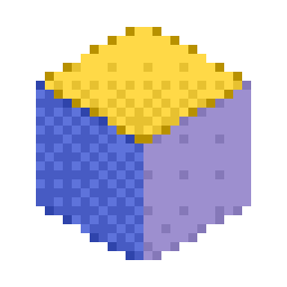

<p align="center">
  <a href="https://peal.social">
    
  </a>
</p>

<h1 align="center">Peal</h1>

<p align="center">
  Write a post once, schedule it across platforms, and see how it performs.<br />
  Fair-source social media scheduling for teams, agents and the apps you build.
</p>

<p align="center">
  <a href="https://peal.social"><strong>Website</strong></a> ·
  <a href="https://docs.peal.social"><strong>Docs</strong></a> ·
  <a href="https://docs.peal.social/reference"><strong>API reference</strong></a> ·
  <a href="https://docs.peal.social/self-hosting"><strong>Self-hosting</strong></a> ·
  <a href="https://status.peal.social"><strong>Status</strong></a> ·
  <a href="https://github.com/orgs/peal-social/projects/1"><strong>Roadmap</strong></a> ·
  <a href="https://github.com/peal-social/peal/issues/new/choose"><strong>Report an issue</strong></a>
</p>

<p align="center">
  <a href="https://github.com/peal-social/peal/actions/workflows/ci.yml"></a>
  <a href="LICENSE.md"></a>
  <a href="packages/peal-sdk"></a>
  <a href="https://www.npmjs.com/package/peal-sdk"></a>
</p>

> [!WARNING]
> Peal is being built in the open and has not been released yet. The hosted
> service at [app.peal.social](https://app.peal.social) is an early preview,
> and there are no published images yet: everything below works from source
> today.

## What's Peal?

Peal is the social media scheduler for teams, agents and the apps you build:
write a post once, schedule it across platforms, and see how it performs.

- **Write once, fit everywhere.** One editor, with its own text on the
  channels that need it, counters for each platform's limits, threads,
  images, videos, PDF documents and alt text.
- **Publish safely.** Each post goes out at its time, in the time zone it was
  scheduled in. When a platform does not confirm a post, Peal checks only in
  ways that cannot post it twice, and asks you before trying again.
- **Work as a team.** Workspaces with roles, review links for people outside
  them, approvals before posts go out, tags, signatures and channel sets.
  Sign in with a password, with Google, or with your own OpenID Connect
  provider on a server you run.
- **See what worked.** Likes, reposts, replies, impressions and followers,
  read back from each platform, by channel and day, with an export, and the
  comments under your posts in one inbox, beside your ads' results.
- **Act on it.** Rules that answer comments holding a keyword, and
  follow-ups that comment under or repost your own post once it has enough
  likes.
- **Built to be built on.** A typed HTTP API, SDKs in eight languages, a
  command line, an MCP endpoint and an agent skill, and signed webhooks.
- **Yours to run.** Self-host it with Postgres and any S3-compatible store.
  Billing, captcha, AI and telemetry stay off until you configure them.
- **Or let us run it.** Peal Cloud is priced per connected account, by the
  day, with your first accounts free and members, workspaces and posts
  unlimited: see the [pricing page](https://peal.social/pricing/).

## Platforms

| Platform                   | Publish |      Analytics      | Inbox                                               |
| -------------------------- | :-----: | :-----------------: | --------------------------------------------------- |
| Mastodon                   |    ✓    |          ✓          | Comments, direct messages                           |
| Bluesky                    |    ✓    |          ✓          | Comments, direct messages                           |
| LinkedIn profiles          |    ✓    |                     |                                                     |
| LinkedIn pages             |    ✓    |          ✓          | Comments (awaiting LinkedIn)                        |
| X                          |    ✓    | ✓ (operator opt-in) |                                                     |
| Threads                    |    ✓    |          ✓          |                                                     |
| Instagram                  |    ✓    |          ✓          | Comments, messages, private replies (awaiting Meta) |
| Facebook Pages             |    ✓    |          ✓          | Comments, messages, private replies (awaiting Meta) |
| TikTok                     |    ✓    |          ✓          |                                                     |
| YouTube                    |    ✓    |          ✓          | Comments (awaiting Google)                          |
| Pinterest                  |    ✓    |          ✓          |                                                     |
| Google Business Profile    |    ✓    |                     | Reviews (awaiting Google)                           |
| Discord (chats)            |    ✓    |                     |                                                     |
| Telegram (chats)           |    ✓    |                     |                                                     |
| Slack (chats)              |    ✓    |                     |                                                     |
| WordPress sites (articles) |    ✓    |                     |                                                     |
| WordPress.com (articles)   |    ✓    |                     |                                                     |
| DEV (articles)             |    ✓    |                     |                                                     |
| Hashnode (articles)        |    ✓    |                     |                                                     |

The inbox reads the comments under the posts Peal published, and answers
them as the connected account. "Awaiting" marks what is built but stays off
until the platform has reviewed the server's app: Meta's App Review for
Facebook's and Instagram's comments, direct messages and private replies,
Google's verification for YouTube's comments and its access for Google
Business Profile's reviews, LinkedIn's comment scopes for its pages. Direct
messages are private correspondence: they are read only where whoever runs
the server turned them on, and then only for the channels a workspace turned
them on for ([Inbox](https://docs.peal.social/guides/engage/inbox)).

Chats (a Discord or Slack channel, a Telegram chat) take posts; websites take
articles, with a formatted body, a featured image, tags and categories
([Websites and articles](https://docs.peal.social/guides/channels/websites)).
Each platform's limits, media rules and the counts it gives are in the docs'
[Platforms](https://docs.peal.social/platforms) and
[Analytics](https://docs.peal.social/guides/engage/analytics) pages.

Ad accounts connect beside the channels, to compare organic and paid
results ([Ads](https://docs.peal.social/guides/engage/ads)): Meta ad
accounts, which can also boost a published post within a monthly ceiling an
owner sets, and Google Ads accounts, read only. Ads stay off until whoever
runs the server turns them on.

## Features

<table>
<tr>
<td width="50%" valign="top">

**Compose and schedule**

- Drafts, a calendar to move posts on, and a media library
- Per-channel text, threads, alt text, YouTube and TikTok options
- A writing assistant, on Anthropic or any OpenAI-compatible model
- Each attempt on each channel, with **Post again** where one failed

</td>
<td width="50%" valign="top">

**Collaborate**

- Workspaces, members, roles and invitations
- Review links with comments and approvals
- Notifications in the app and by email
- Sign-in with a password, with Google, or with an OpenID Connect provider on a self-hosted server ([Single sign-on](https://docs.peal.social/self-hosting/single-sign-on))
- A staff console with an audit log, for whoever runs the instance

</td>
</tr>
<tr>
<td width="50%" valign="top">

**Measure and engage**

- Post and account counts by channel and day, against the period before
- Each post's counts over time, the best posts, and an export
- An [inbox](https://docs.peal.social/guides/engage/inbox) for comments and direct messages, answered as the connected account
- [Ads](https://docs.peal.social/guides/engage/ads): Meta ads read and boosted within a ceiling, Google Ads read only

</td>
<td width="50%" valign="top">

**Automate and integrate**

- [Comment rules](https://docs.peal.social/guides/engage/inbox#comment-rules) that answer comments holding a keyword, and [follow-ups](https://docs.peal.social/guides/posts/queues#follow-ups) that comment under or repost a post once it has enough likes
- An [HTTP API](https://docs.peal.social/developers) with workspace API keys and OAuth
- [Webhooks](https://docs.peal.social/developers/webhooks) signed as Standard Webhooks says
- The [`peal` command line](https://docs.peal.social/developers/cli) and an [MCP endpoint](https://docs.peal.social/developers/mcp)
- [Embedding](https://docs.peal.social/developers/embedding) with partner accounts and connect links

</td>
</tr>
</table>

## Official Peal SDKs

Generated from the API contract, published to each language's registry, and
licensed under Apache-2.0.

<p align="center">
  <a href="packages/peal-sdk/node"></a>
  <a href="packages/peal-sdk/python"></a>
  <a href="packages/peal-sdk/go"></a>
  <a href="packages/peal-sdk/ruby"></a>
  <a href="packages/peal-sdk/java"></a>
  <a href="packages/peal-sdk/php"></a>
  <a href="packages/peal-sdk/dotnet"></a>
  <a href="packages/peal-sdk/rust"></a>
</p>

```ts
import { PealClient } from "peal-sdk";

const peal = new PealClient({ token: process.env.PEAL_API_KEY });
const me = await peal.session.me();
```

AI agents work in a workspace through the
[MCP endpoint](https://docs.peal.social/developers/mcp), the
[`peal` command line](https://docs.peal.social/developers/cli) or the
[agent skill](packages/peal-skills/skills/peal/SKILL.md), drafting posts for a person to review or
publishing them, as the workspace allows.

## Self-hosting

Peal runs anywhere Docker does. You need:

- a server with Docker Engine 28 and Compose 2.35 or later, and a domain
  pointing at it;
- Postgres (included in the stack) and an S3-compatible store;
- a way to send email: SMTP or Resend.

Billing, captcha, the writing assistant, ads and telemetry stay off until you
configure them, so nothing is limited and nothing leaves your server.

```sh
git clone https://github.com/peal-social/peal.git && cd peal/packages/peal-docker
mkdir -p /srv/peal && cp self-host.env.example /srv/peal/peal.env   # then fill it in
docker compose --project-name peal --file compose.production.yaml \
  --file compose.self-host.yaml --env-file /srv/peal/peal.env up --build --detach --wait
```

Caddy then serves Peal on your domain, with a Let's Encrypt certificate. The
[self-hosting guide](https://docs.peal.social/self-hosting) explains each
service and how to connect each platform, and
[environment variables](https://docs.peal.social/self-hosting/environment-variables) lists
every setting.

## Resources

- [Documentation](https://docs.peal.social)
- [Roadmap](https://github.com/orgs/peal-social/projects/1)
- [API reference](https://docs.peal.social/reference)
- [Self-hosting guide](https://docs.peal.social/self-hosting)
- [Bug tracker](https://github.com/peal-social/peal/issues) (bugs, platform
  quirks, feature requests, self-hosting help)
- [Contributing](.github/CONTRIBUTING.md) (developing Peal, running it from
  source)
- [Security policy](SECURITY.md) (report a vulnerability privately)
- [Status](https://status.peal.social)
- [Code](https://github.com/peal-social/peal)

## Licensing

Peal's licensor is Peal. Each part of the repository is under one of two
licences:

| Part                                                         | Licence                                                                                                  |
| ------------------------------------------------------------ | -------------------------------------------------------------------------------------------------------- |
| Everything, unless a folder below has a `LICENSE` of its own | [FSL-1.1-ALv2](LICENSE.md): any use but a competing service, and Apache-2.0 two years after each release |
| [`peal-contract`](packages/peal-contract), the API contract  | [Apache-2.0](packages/peal-contract/LICENSE)                                                             |
| [`peal-sdk`](packages/peal-sdk), the SDKs                    | [Apache-2.0](packages/peal-sdk/LICENSE)                                                                  |
| [`peal-skills`](packages/peal-skills), the agent skill       | [Apache-2.0](packages/peal-skills/LICENSE)                                                               |

Peal is fair source, not open source: you may use, modify and self-host it for
anything but offering it to others as a competing service, and each release
becomes Apache-2.0 two years after it ships. The SDKs are generated from the
contract's OpenAPI document, so the contract is Apache-2.0 with them: what an
SDK user installs, and the API description it comes from, carry no FSL terms.
Each `package.json` says which licence applies, and each Apache-2.0 package
has a `NOTICE` naming Peal as its copyright holder.
