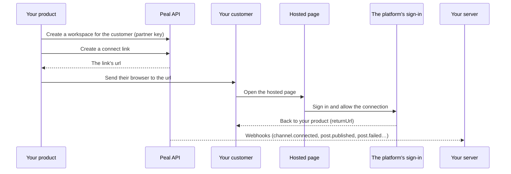

Your customers don't need a Peal account, and they never see Peal's app. Your backend posts for them through the API, and they only ever see your product and a page with your name on it.

Five pieces make it work:

| Piece                            | What it is                                                     |
| -------------------------------- | -------------------------------------------------------------- |
| [Partner account](#account)      | What you hold                                                  |
| [Workspace](#workspaces)         | One for each of your customers, owned by the partner account   |
| Partner key                      | What your backend acts in those workspaces with                |
| [Hosted page](#connect)          | Where you send your customers to connect their social accounts |
| [Webhooks](/developers/webhooks) | How Peal tells your server what happens                        |



Peal isolates by workspace. A workspace's channels, posts, media, analytics and webhooks belong to it alone, and deleting it erases all of them. Give each customer their own, and one customer's accounts and posts are out of every other's reach by construction, with no filter in your code to get wrong.

## Get a partner account [#account]

A partner account belongs to a workspace of yours, called its home workspace. That's the one you signed up with, where your team's members are. The owners and admins of that workspace run the account.

How you get one depends on where Peal runs:

- On Peal Cloud, Peal's team opens partner accounts. Write to us with what you're building.
- On a self-hosted Peal, staff grant one from the [staff console](/self-hosting/staff#partners), on a workspace's page. Set [`PEAL_PARTNER_SELF_SERVICE`](/self-hosting/environment-variables#sign-in) to `true`, and the owners and admins of any workspace can open one themselves, under **Settings**, then **Partner**.

Then set it up in the web app, under **Settings**, then **Partner**:

<Steps>
  <Step title="Set your name, logo and accent colour">
    Your customers read them on the hosted pages. The name has 80 characters at
    most. The logo is an HTTPS address, which their browser loads from your
    server. The accent colour is drawn as a line along the top of the page's
    card, above your logo.
  </Step>
  <Step title="Add your return origins">
    These are the origins a hosted page may send your customers back to, such as
    `https://app.example.com`: scheme, host and port, with nothing after, and 20
    at most. Plain `http://` is accepted for `localhost` only, so you can try
    the flow in development. A hosted page returns to an address on one of these
    origins, exactly, and nowhere else.
  </Step>
  <Step title="Create a partner key">
    Give it a name, what it may do with your workspaces and what it may do
    inside each. The key is shown once, so put it straight into your backend's
    secrets.
  </Step>
</Steps>

### Accent colour [#accent]

The accent colour is six hexadecimal digits, such as `#415EEE`. You can also set it with `accentColor` in `PATCH /api/workspaces/{workspaceId}/partner`, and remove it with `null`.

Peal's pages are light, and the line has to be visible. So the colour needs a contrast of at least 3:1 with white and with the page's background (`#FAFAF9`), which is the bar WCAG sets for such a line. A lighter colour, or anything other than `#RRGGBB`, answers 422 `PartnerDetailsInvalid` with `field` `accentColor`, and nothing is saved.

Buttons and text keep Peal's colours, so they stay readable whatever colour you pick.

### Partner keys [#keys]

A partner key starts with `peal_partner_`, and you send it as `Authorization: Bearer peal_partner_…`. Only a signed-in owner or admin can create one, in the web app. No key and no application can create keys.

You can revoke a key in the same place, or with `DELETE /api/workspaces/{workspaceId}/partner/keys/{partnerKeyId}`. It stops working at once.

The list shows who made each key (`createdBy`). A key follows its maker: it stops working once they leave your home workspace, are removed from it or close their account, and once their role there is one that can't manage the partner account (anything below admin). Before a removal or such a role change, the web app says how many of their keys stop working. So that your backend keeps running when someone leaves, have it use a key made by an owner who stays.

A key's scopes decide what it does with your workspaces:

| A key's scope       | What it allows                                        |
| ------------------- | ----------------------------------------------------- |
| `workspaces:read`   | List and read the workspaces the partner account owns |
| `workspaces:write`  | Create them, rename them, change their external id    |
| `workspaces:delete` | Delete one, with everything in it                     |

Inside each workspace the account owns, the key holds the [permissions](/guides/posts#roles) you ticked. You can pick among those a product needs for its customers:

- `channel:*`, `media:*`, `post:*`, `analytics:read`, `assistant:use`, `webhook:*` and `billing:read`.
- `engagement:read` and `engagement:reply`, for the [comments](/guides/engage/inbox) under a customer's posts and for answering them in public as its account. Other people wrote those comments, so only give a key these if your product shows or answers them.
- `assistant:configure`, to set each customer's own [image provider](/guides/workspace#providers) with `PUT /api/workspaces/{workspaceId}/assistant/image-provider`, one workspace at a time, with the customer's key.
- `activity:read`, which reads the workspace's [activity log](/guides/workspace#activity): what your key asked to change there, and the accounts connected through connect links.

A partner key never gets the [direct messages](/guides/engage/inbox#direct-messages) permissions (`engagement:readMessages`, `engagement:message`). Only a workspace's owner, in person, can let an application into them, and a customer's workspace has no owner.

It never holds what belongs to people either: members, invitations, API keys and billing changes.

### What a partner key reaches [#isolation]

Here's what a partner key gets, depending on where it calls:

| With a partner key                                         | Answer                     |
| ---------------------------------------------------------- | -------------------------- |
| A workspace its partner account owns                       | What its permissions allow |
| A workspace another partner owns                           | 404, as if it didn't exist |
| Any other workspace, your home workspace included          | 404                        |
| `/api/me`, members, invitations, API keys of any workspace | 403                        |

It works the other way round too. An API key of a workspace, a member's session or an OAuth token never calls `/api/partner`, and gets 403 if it tries.

[Two-step verification](/guides/workspace#require-two-step) applies to people. It doesn't affect partner keys, or your customers' workspaces, which have no members. Your home workspace's owners can still require it of its members, as in any workspace.

## Create a workspace for each customer [#workspaces]

When a customer signs up with you, create their workspace and give it your own id for them as its `externalId`. Peal keeps it, finds the workspace by it, and writes it in every [webhook](/developers/embedding/operate#webhooks) of that workspace. You don't need a table that maps your ids to Peal's.

<CodeGroup>

```ts Node.js
import { PealClient } from "peal-sdk";

const peal = new PealClient({
  token: process.env.PEAL_PARTNER_KEY,
  baseUrl: "https://api.example.com",
});

const workspace = await peal.partner.createWorkspace({
  name: "Boulangerie Martin",
  externalId: "cus_42",
  "idempotency-key": "signup-cus_42",
});
// Every other call takes workspace.id as its workspaceId.
```

```python Python
import os

from peal import Peal

peal = Peal(token=os.environ["PEAL_PARTNER_KEY"], base_url="https://api.example.com")

workspace = peal.partner.create_workspace(
    name="Boulangerie Martin",
    external_id="cus_42",
    idempotency_key="signup-cus_42",
)
# Every other call takes workspace.id as its workspace_id.
```

```go Go
import (
	"context"
	"os"

	peal "github.com/peal-social/peal/packages/peal-sdk/go"
	pealclient "github.com/peal-social/peal/packages/peal-sdk/go/client"
	"github.com/peal-social/peal/packages/peal-sdk/go/option"
)

client := pealclient.NewClient(
	option.WithToken(os.Getenv("PEAL_PARTNER_KEY")),
	option.WithBaseURL("https://api.example.com"),
)
ctx := context.TODO()

workspace, err := client.Partner.CreateWorkspace(ctx, &peal.NewCustomerWorkspace{
	Name:           "Boulangerie Martin",
	ExternalID:     peal.String("cus_42"),
	IdempotencyKey: peal.String("signup-cus_42"),
})
// Every other call takes workspace.ID as its WorkspaceID.
```

```ruby Ruby
require "peal"

peal = Peal::Client.new(token: ENV.fetch("PEAL_PARTNER_KEY"), base_url: "https://api.example.com")

workspace = peal.partner.create_workspace(
  name: "Boulangerie Martin",
  external_id: "cus_42",
  idempotency_key: "signup-cus_42"
)
# Every other call takes workspace.id as its workspace_id.
```

```java Java
import social.peal.PealClient;
import social.peal.resources.partner.requests.NewCustomerWorkspace;
import social.peal.types.CustomerWorkspace;

PealClient peal = PealClient.builder()
    .token(System.getenv("PEAL_PARTNER_KEY"))
    .url("https://api.example.com")
    .build();

CustomerWorkspace workspace = peal.partner().createWorkspace(
    NewCustomerWorkspace.builder()
        .name("Boulangerie Martin")
        .externalId("cus_42")
        .idempotencyKey("signup-cus_42")
        .build());
// Every other call takes workspace.getId() as its workspaceId.
```

```php PHP
<?php
use Peal\PealClient;
use Peal\Partner\Requests\NewCustomerWorkspace;

$peal = new PealClient(
    token: getenv('PEAL_PARTNER_KEY'),
    options: ['baseUrl' => 'https://api.example.com'],
);

$workspace = $peal->partner->createWorkspace(new NewCustomerWorkspace([
    'name' => 'Boulangerie Martin',
    'externalId' => 'cus_42',
    'idempotencyKey' => 'signup-cus_42',
]));
// Every other call takes $workspace->id as its workspaceId.
```

```csharp .NET
using Peal;

var peal = new PealClient(
    Environment.GetEnvironmentVariable("PEAL_PARTNER_KEY")!,
    new ClientOptions { BaseUrl = "https://api.example.com" }
);

var workspace = await peal.Partner.CreateWorkspaceAsync(new NewCustomerWorkspace
{
    Name = "Boulangerie Martin",
    ExternalId = "cus_42",
    IdempotencyKey = "signup-cus_42",
});
// Every other call takes workspace.Id as its WorkspaceId.
```

```rust Rust
use peal_sdk::prelude::*;

let peal = PealClient::new(ClientConfig {
    token: std::env::var("PEAL_PARTNER_KEY").ok(),
    base_url: "https://api.example.com".to_string(),
    ..Default::default()
})?;

let workspace = peal
    .partner
    .create_workspace(
        &NewCustomerWorkspace {
            name: "Boulangerie Martin".to_string(),
            external_id: Some("cus_42".to_string()),
        },
        // The Rust SDK sends the Idempotency-Key header through the request's options.
        Some(RequestOptions::new().additional_header("Idempotency-Key", "signup-cus_42")),
    )
    .await?;
// Every other call takes workspace.id as its workspace_id.
```

```bash curl
curl -X POST https://api.example.com/api/partner/workspaces \
  -H "Authorization: Bearer $PEAL_PARTNER_KEY" \
  -H "Content-Type: application/json" \
  -H "Idempotency-Key: signup-cus_42" \
  -d '{"name": "Boulangerie Martin", "externalId": "cus_42"}'
```

</CodeGroup>

A workspace you create has no members. Nobody signs in to it, and only your keys act in it.

### Send a creation again safely [#create-again]

A signup can time out, and your code will try again. Two things keep that from making a second workspace:

| By                | What happens                                                                                                                                                                                 |
| ----------------- | -------------------------------------------------------------------------------------------------------------------------------------------------------------------------------------------- |
| `externalId`      | It's unique among your workspaces. A second workspace with the same one answers 409 `ExternalIdTaken`, and its `workspaceId` is the workspace that has it. A retried signup never makes two. |
| `Idempotency-Key` | For 24 hours, the same key with the same body answers the workspace the first request made, and makes no other. The same key with another body answers 409 `IdempotencyKeyReused`.           |

### Find and change your workspaces [#manage-workspaces]

The partner API has these requests:

| Request                                        | What it does                                                                                                                                |
| ---------------------------------------------- | ------------------------------------------------------------------------------------------------------------------------------------------- |
| `GET /api/partner`                             | The partner account, and what it holds: workspaces and channels, now and at the end of each of the last 35 days                             |
| `GET /api/partner/workspaces`                  | Your workspaces, newest first, each with its number of channels: `externalId` finds one exactly, `name` searches, `limit` and `before` page |
| `POST /api/partner/workspaces`                 | Creates one                                                                                                                                 |
| `GET /api/partner/workspaces/{workspaceId}`    | Reads one                                                                                                                                   |
| `PATCH /api/partner/workspaces/{workspaceId}`  | Changes its name or its external id (`null` removes it)                                                                                     |
| `DELETE /api/partner/workspaces/{workspaceId}` | Deletes it, with everything in it ([Offboard a customer](/developers/embedding/operate#offboard))                                           |

To find a customer's workspace by your own id:

<CodeGroup>

```ts Node.js
const { workspaces } = await peal.partner.listWorkspaces({
  externalId: "cus_42",
});
```

```python Python
page = peal.partner.list_workspaces(external_id="cus_42")
```

```go Go
page, err := client.Partner.ListWorkspaces(ctx, &peal.ListWorkspacesPartnerRequest{
	ExternalID: peal.String("cus_42"),
})
```

```ruby Ruby
page = peal.partner.list_workspaces(external_id: "cus_42")
```

```java Java
import social.peal.resources.partner.requests.ListWorkspacesPartnerRequest;
import social.peal.types.CustomerWorkspacePage;

CustomerWorkspacePage page = peal.partner().listWorkspaces(
    ListWorkspacesPartnerRequest.builder()
        .externalId("cus_42")
        .build());
```

```php PHP
use Peal\Partner\Requests\ListWorkspacesPartnerRequest;

$page = $peal->partner->listWorkspaces(new ListWorkspacesPartnerRequest([
    'externalId' => 'cus_42',
]));
```

```csharp .NET
var page = await peal.Partner.ListWorkspacesAsync(new ListWorkspacesPartnerRequest
{
    ExternalId = "cus_42",
});
```

```rust Rust
let page = peal
    .partner
    .list_workspaces(
        &PartnerListWorkspacesQueryRequest {
            external_id: Some("cus_42".to_string()),
            ..Default::default()
        },
        None,
    )
    .await?;
```

```bash curl
curl "https://api.example.com/api/partner/workspaces?externalId=cus_42" \
  -H "Authorization: Bearer $PEAL_PARTNER_KEY"
```

```sh CLI
peal partner workspaces --external-id cus_42
```

```json MCP (list_partner_workspaces)
{ "externalId": "cus_42" }
```

</CodeGroup>

The command line and the MCP tool read the same list as a person, signed in to your home workspace, rather than with the partner key.

A list answers `total`, the number of workspaces the filters find in all, and `next`. Pass `next` as `before`, as it is, for the next page, until it's null. It's a position in the list, not a workspace's id, so it stays good when the workspaces before it are offboarded. Anything else in `before` answers 400.

## Let a customer connect their accounts [#connect]

Your customer owns their social accounts, and only they can sign in to them. You create a connect link for one platform, or for several at once, and send their browser to it. They come back to your product once the account is connected.

They never type a password into your product. Peal never sees their password either, because the platform's own sign-in page asks for it.

<CodeGroup>

```ts Node.js
const { link, url } = await peal.connectLinks.create({
  workspaceId: workspace.id,
  platform: "linkedin",
  returnUrl: "https://app.example.com/settings/social",
  expiresInHours: 24,
  locale: "fr",
});
// Keep link.id with your customer, then redirect their browser to url.
```

```python Python
created = peal.connect_links.create(
    workspace.id,
    platform="linkedin",
    return_url="https://app.example.com/settings/social",
    expires_in_hours=24,
    locale="fr",
)
# Keep created.link.id with your customer, then redirect their browser to created.url.
```

```go Go
created, err := client.ConnectLinks.Create(ctx, &peal.NewConnectLink{
	WorkspaceID:    workspace.ID,
	Platform:       peal.PlatformLinkedin.Ptr(),
	ReturnURL:      peal.String("https://app.example.com/settings/social"),
	ExpiresInHours: peal.Int(24),
	Locale:         peal.ConnectLinkLocaleFr.Ptr(),
})
// Keep created.Link.ID with your customer, then redirect their browser to created.URL.
```

```ruby Ruby
created = peal.connect_links.create(
  workspace_id: workspace.id,
  platform: "linkedin",
  return_url: "https://app.example.com/settings/social",
  expires_in_hours: 24,
  locale: "fr"
)
# Keep created.link.id with your customer, then redirect their browser to created.url.
```

```java Java
import social.peal.resources.connectlinks.requests.NewConnectLink;
import social.peal.types.ConnectLinkLocale;
import social.peal.types.CreatedConnectLink;
import social.peal.types.Platform;

CreatedConnectLink created = peal.connectLinks().create(
    workspace.getId(),
    NewConnectLink.builder()
        .platform(Platform.LINKEDIN)
        .returnUrl("https://app.example.com/settings/social")
        .expiresInHours(24)
        .locale(ConnectLinkLocale.FR)
        .build());
// Keep created.getLink().getId() with your customer, then redirect their browser to created.getUrl().
```

```php PHP
use Peal\ConnectLinks\Requests\NewConnectLink;

$created = $peal->connectLinks->create($workspace->id, new NewConnectLink([
    'platform' => 'linkedin',
    'returnUrl' => 'https://app.example.com/settings/social',
    'expiresInHours' => 24,
    'locale' => 'fr',
]));
// Keep $created->link->id with your customer, then redirect their browser to $created->url.
```

```csharp .NET
var created = await peal.ConnectLinks.CreateAsync(new NewConnectLink
{
    WorkspaceId = workspace.Id,
    Platform = Platform.Linkedin,
    ReturnUrl = "https://app.example.com/settings/social",
    ExpiresInHours = 24,
    Locale = ConnectLinkLocale.Fr,
});
// Keep created.Link.Id with your customer, then redirect their browser to created.Url.
```

```rust Rust
let created = peal
    .connect_links
    .create(
        &workspace.id,
        &NewConnectLink {
            platform: Some(Platform::Linkedin),
            return_url: Some("https://app.example.com/settings/social".to_string()),
            expires_in_hours: Some(24),
            locale: Some(ConnectLinkLocale::Fr),
            ..Default::default()
        },
        None,
    )
    .await?;
// Keep created.link.id with your customer, then redirect their browser to created.url.
```

```bash curl
curl -X POST https://api.example.com/api/workspaces/$WORKSPACE_ID/connect-links \
  -H "Authorization: Bearer $PEAL_PARTNER_KEY" \
  -H "Content-Type: application/json" \
  -d '{"platform": "linkedin", "returnUrl": "https://app.example.com/settings/social", "expiresInHours": 24, "locale": "fr"}'
```

</CodeGroup>

The answer's `url` is shown once, because Peal keeps only a digest of the token in it. Creating a link needs `channel:connect`.

A link takes these fields:

| Field            | What it is                                                                                                                                                                                                                                                                                                                                                                     |
| ---------------- | ------------------------------------------------------------------------------------------------------------------------------------------------------------------------------------------------------------------------------------------------------------------------------------------------------------------------------------------------------------------------------ |
| `platform`       | One of the platforms [the instance connects](/guides/channels#connect)                                                                                                                                                                                                                                                                                                         |
| `platforms`      | Several of them instead of `platform`, each once, such as `["instagram", "linkedin", "mastodon"]`. The page offers each in that order ([Several platforms](#several)). Send one or the other, never both, and only one platform with `channelId`, or the request answers 400.                                                                                                  |
| `returnUrl`      | Where the page sends them once they're done. Its origin must be one of your [return origins](#account), exactly, or the request answers 422 `ReturnUrlNotAllowed`.                                                                                                                                                                                                             |
| `expiresInHours` | How long the link works, from 1 to 720 (30 days). It's 168 (a week) unless you say otherwise.                                                                                                                                                                                                                                                                                  |
| `locale`         | `en` or `fr`, the language the page opens in. Leave it out and the page uses the visitor's own.                                                                                                                                                                                                                                                                                |
| `channelId`      | A channel to reconnect, instead of connecting a new account ([Reconnect](#reconnect))                                                                                                                                                                                                                                                                                          |
| `connection`     | The way in, on platforms that have several. For Instagram, `unifiedLogin` (a business portfolio), `instagramLogin` or `facebookLogin` ([Instagram](/platforms/instagram#connect)). For LinkedIn, `linkedinProfile` (the member's profile) or `linkedinPage` (the company pages they manage) ([LinkedIn](/platforms/linkedin#connect)). Leave it out to use the server's first. |

### Several platforms in one link [#several]

With `platforms`, your customer can connect an account on each of them from one page, in one visit or several. The page lists the platforms, marks the ones already connected, and starts one sign-in at a time. After each, it offers **Connect another account**, or **Continue** back to your `returnUrl`.

<CodeGroup>

```ts Node.js
const { link, url } = await peal.connectLinks.create({
  workspaceId: workspace.id,
  platforms: ["instagram", "linkedin", "mastodon"],
  returnUrl: "https://app.example.com/settings/social",
});
```

```python Python
created = peal.connect_links.create(
    workspace.id,
    platforms=["instagram", "linkedin", "mastodon"],
    return_url="https://app.example.com/settings/social",
)
```

```go Go
created, err := client.ConnectLinks.Create(ctx, &peal.NewConnectLink{
	WorkspaceID: workspace.ID,
	Platforms:   []peal.Platform{peal.PlatformInstagram, peal.PlatformLinkedin, peal.PlatformMastodon},
	ReturnURL:   peal.String("https://app.example.com/settings/social"),
})
```

```ruby Ruby
created = peal.connect_links.create(
  workspace_id: workspace.id,
  platforms: %w[instagram linkedin mastodon],
  return_url: "https://app.example.com/settings/social"
)
```

```java Java
import java.util.List;

CreatedConnectLink created = peal.connectLinks().create(
    workspace.getId(),
    NewConnectLink.builder()
        .platforms(List.of(Platform.INSTAGRAM, Platform.LINKEDIN, Platform.MASTODON))
        .returnUrl("https://app.example.com/settings/social")
        .build());
```

```php PHP
$created = $peal->connectLinks->create($workspace->id, new NewConnectLink([
    'platforms' => ['instagram', 'linkedin', 'mastodon'],
    'returnUrl' => 'https://app.example.com/settings/social',
]));
```

```csharp .NET
var created = await peal.ConnectLinks.CreateAsync(new NewConnectLink
{
    WorkspaceId = workspace.Id,
    Platforms = new[] { Platform.Instagram, Platform.Linkedin, Platform.Mastodon },
    ReturnUrl = "https://app.example.com/settings/social",
});
```

```rust Rust
let created = peal
    .connect_links
    .create(
        &workspace.id,
        &NewConnectLink {
            platforms: Some(vec![Platform::Instagram, Platform::Linkedin, Platform::Mastodon]),
            return_url: Some("https://app.example.com/settings/social".to_string()),
            ..Default::default()
        },
        None,
    )
    .await?;
```

```bash curl
curl -X POST https://api.example.com/api/workspaces/$WORKSPACE_ID/connect-links \
  -H "Authorization: Bearer $PEAL_PARTNER_KEY" \
  -H "Content-Type: application/json" \
  -d '{"platforms": ["instagram", "linkedin", "mastodon"], "returnUrl": "https://app.example.com/settings/social"}'
```

</CodeGroup>

While the link waits, it tells you how far your customer got:

| While it waits       | What you read                                                  |
| -------------------- | -------------------------------------------------------------- |
| `connectedPlatforms` | The platforms it connected so far                              |
| `channelIds`         | The channels it connected so far, in the order it did          |
| `status`             | `pending` until each platform connected once, then `completed` |

Each platform connects once. A second sign-in on a platform that's already connected answers `platformNotOffered`. The link's 20 sign-ins are counted across all its platforms.

Revoke the link once your customer is done, or let it expire. Either way, what it connected stays connected, and `channelIds` still says what.

### What your customer sees [#hosted-page]

The hosted page takes your customer through four screens:

<Steps>
  <Step title="Your name, logo and accent colour">
    One sentence says you're asking to connect their account on that platform,
    to publish there for them. For Mastodon, the page asks for their server. For
    Bluesky, it asks for their handle.
  </Step>
  <Step title="The platform's sign-in page">
    They sign in there and allow the connection.
  </Step>
  <Step title="A choice of accounts">
    Sometimes the sign-in reaches several accounts: the Pages a Facebook user
    manages, the Instagram accounts linked to them, or a Google account's
    YouTube channels. They tick the ones to connect.
  </Step>
  <Step title="Back to your returnUrl">
    The page sends them back to your product.
  </Step>
</Steps>

The page is in English or French. It shows none of Peal's app, and says that Peal handles the connection. Search engines are kept out of it.

### When they come back [#return]

Peal adds two parameters to your `returnUrl`, replacing any with the same name:

| Parameter     | Value                                                                |
| ------------- | -------------------------------------------------------------------- |
| `peal_link`   | The link's id                                                        |
| `peal_status` | `connected`, `cancelled` (they chose to go back instead) or `failed` |

<Callout type="warning" title="Anyone can write those parameters">
  Take them as a hint to look, never as proof. The link you read with your key
  is what counts.
</Callout>

Read the link with your key to find out what really happened:

<CodeGroup>

```ts Node.js
const link = await peal.connectLinks.get({ workspaceId, linkId });

if (link.status === "completed") {
  // link.channelIds holds the channels it connected.
}
```

```python Python
link = peal.connect_links.get(workspace_id, link_id)

if link.status == "completed":
    # link.channel_ids holds the channels it connected.
    pass
```

```go Go
link, err := client.ConnectLinks.Get(ctx, &peal.GetConnectLinksRequest{
	WorkspaceID: workspaceID,
	LinkID:      linkID,
})

if link.Status == peal.ConnectLinkStatusCompleted {
	// link.ChannelIDs holds the channels it connected.
}
```

```ruby Ruby
link = peal.connect_links.get(workspace_id: workspace_id, link_id: link_id)

if link.status == "completed"
  # link.channel_ids holds the channels it connected.
end
```

```java Java
import social.peal.types.ConnectLink;
import social.peal.types.ConnectLinkStatus;

ConnectLink link = peal.connectLinks().get(workspaceId, linkId);

if (link.getStatus().equals(ConnectLinkStatus.COMPLETED)) {
    // link.getChannelIds() holds the channels it connected.
}
```

```php PHP
$link = $peal->connectLinks->get($workspaceId, $linkId);

if ($link->status === 'completed') {
    // $link->channelIds holds the channels it connected.
}
```

```csharp .NET
var link = await peal.ConnectLinks.GetAsync(new GetConnectLinksRequest
{
    WorkspaceId = workspaceId,
    LinkId = linkId,
});

if (link.Status == ConnectLinkStatus.Completed)
{
    // link.ChannelIds holds the channels it connected.
}
```

```rust Rust
let link = peal.connect_links.get(&workspace_id, &link_id, None).await?;

if link.status == ConnectLinkStatus::Completed {
    // link.channel_ids holds the channels it connected.
}
```

```bash curl
curl https://api.example.com/api/workspaces/$WORKSPACE_ID/connect-links/$LINK_ID \
  -H "Authorization: Bearer $PEAL_PARTNER_KEY"
```

</CodeGroup>

A link's `status` is one of these:

| A link's `status` | Meaning                                                                       |
| ----------------- | ----------------------------------------------------------------------------- |
| `pending`         | It waits to be used. If its last sign-in failed, `failure` says how it ended. |
| `completed`       | It connected the channels in `channelIds`, and opens nothing more             |
| `revoked`         | You took it back                                                              |
| `expired`         | Its time ran out                                                              |

Don't rely on the browser alone, because your customer may close the tab before they come back. Subscribe to [`channel.connected`](/developers/webhooks/events/channels#channel-connected) as well. Peal sends it when the account is connected, with the workspace's `workspaceExternalId`.

To revoke a link, send `DELETE /api/workspaces/{workspaceId}/connect-links/{linkId}`. `GET …/connect-links` lists a workspace's links: those waiting, and those that ended in the last 30 days.

### Reconnect [#reconnect]

When a platform stops accepting a channel's authorization, Peal sends [`channel.reconnect_needed`](/developers/webhooks/events/channels#channel-reconnect-needed). Create a link with that channel's `channelId`.

Its page names the account, and only a sign-in to that same account goes through. The channel keeps its id, its posts and its analytics.

### What a link can and can't do [#link-security]

A connect link lets someone connect an account to one workspace, and nothing more. Its address still needs care.

<Callout type="warning" title="Anyone with the link can connect an account">
  Until it's used, revoked or expired, whoever holds its address can connect an
  account of theirs to that workspace. Send your customer's browser to it from a
  page they're signed in to, or over a channel you trust. Give it the shortest
  life that fits, and revoke the ones you no longer need.
</Callout>

Here's what a link can and can't do:

- It's used once per platform, by a sign-in that connects an account there. Opening it uses nothing, so a link preview doesn't spend it.
- It gives nothing else. It reads no post, no channel and no token, and reaches no other workspace.
- Only the browser that started the sign-in can complete it. The platform's answer, replayed in another browser, connects nothing.
- It returns only where you said. A `returnUrl` on an origin you didn't register is refused when the link is created, so a link never sends anyone to someone else's site.
- A link's sign-in can be started 20 times, and a workspace has 100 links waiting at most.

After a connection, show your customer which account was connected (`GET …/channels` gives its handle). That way they can tell if it isn't the one they meant.
