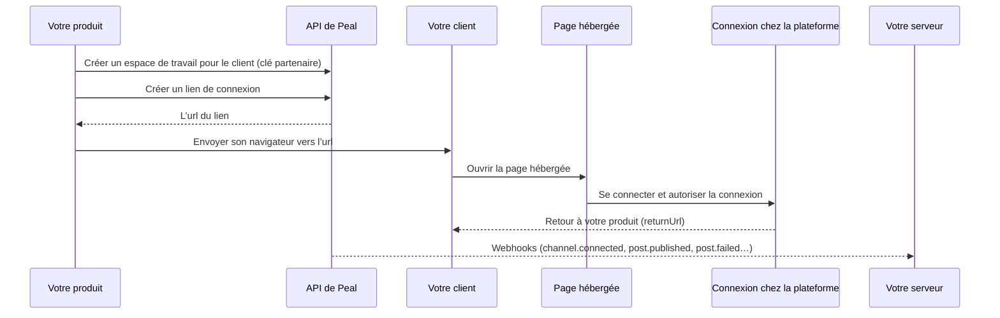

Vos clients n’ont pas besoin de compte Peal, et ne voient jamais l’application de Peal. Votre serveur publie pour eux par l’API, et eux ne voient que votre produit et une page à votre nom.

Cinq éléments s’assemblent :

| Élément                          | Ce que c’est                                                    |
| -------------------------------- | --------------------------------------------------------------- |
| [Compte partenaire](#account)    | Ce que vous détenez                                             |
| [Espace de travail](#workspaces) | Un pour chacun de vos clients, que possède le compte partenaire |
| Clé partenaire                   | Ce avec quoi votre serveur agit dans ces espaces de travail     |
| [Page hébergée](#connect)        | Là où vous envoyez vos clients connecter leurs comptes sociaux  |
| [Webhooks](/developers/webhooks) | La façon dont Peal dit à votre serveur ce qui se passe          |



Peal isole par espace de travail. Les canaux, les publications, les médias, les statistiques et les webhooks d’un espace n’appartiennent qu’à lui, et le supprimer les efface tous. Donnez-en un à chaque client, et les comptes et publications de l’un sont hors de portée de tous les autres par construction, sans filtre à ne pas rater dans votre code.

## Obtenir un compte partenaire [#account]

Un compte partenaire appartient à l’un de vos espaces de travail, appelé son espace de travail principal. C’est celui avec lequel vous vous êtes inscrit, où se trouvent les membres de votre équipe. Les propriétaires et administrateurs de cet espace gèrent le compte.

La façon d’en obtenir un dépend de l’endroit où tourne Peal :

- Sur Peal Cloud, c’est l’équipe de Peal qui ouvre les comptes partenaires. Écrivez-nous en disant ce que vous construisez.
- Sur un Peal auto-hébergé, l’équipe d’administration en accorde un depuis la [console d’administration](/self-hosting/staff#partners), sur la page d’un espace de travail. Mettez [`PEAL_PARTNER_SELF_SERVICE`](/self-hosting/environment-variables#sign-in) à `true`, et les propriétaires et administrateurs de n’importe quel espace de travail peuvent en ouvrir un eux-mêmes, sous **Paramètres**, puis **Partenaire**.

Réglez-le ensuite dans l’application web, sous **Paramètres**, puis **Partenaire** :

<Steps>
  <Step title="Réglez votre nom, votre logo et votre couleur d’accent">
    Vos clients les lisent sur les pages hébergées. Le nom fait 80 caractères au
    plus. Le logo est une adresse HTTPS, que leur navigateur charge depuis votre
    serveur. La couleur d’accent est tracée en une ligne en haut de la carte de
    la page, au-dessus de votre logo.
  </Step>
  <Step title="Ajoutez vos origines de retour">
    Ce sont les origines vers lesquelles une page hébergée peut renvoyer vos
    clients, comme `https://app.example.com` : schéma, hôte et port, sans rien
    après, et 20 au plus. Le simple `http://` n’est accepté que pour
    `localhost`, pour essayer le parcours en développement. Une page hébergée
    revient à une adresse située sur l’une de ces origines, exactement, et nulle
    part ailleurs.
  </Step>
  <Step title="Créez une clé partenaire">
    Donnez-lui un nom, ce qu’elle peut faire de vos espaces de travail et ce
    qu’elle peut faire dans chacun. La clé n’est affichée qu’une fois, alors
    rangez-la tout de suite dans les secrets de votre serveur.
  </Step>
</Steps>

### Couleur d’accent [#accent]

La couleur d’accent tient en six chiffres hexadécimaux, comme `#415EEE`. Vous pouvez aussi la régler avec `accentColor` dans `PATCH /api/workspaces/{workspaceId}/partner`, et la retirer avec `null`.

Les pages de Peal sont claires, et la ligne doit se voir. La couleur demande donc un contraste d’au moins 3:1 avec le blanc et avec le fond de la page (`#FAFAF9`), le seuil que fixent les WCAG pour une telle ligne. Une couleur plus claire, ou autre chose que `#RRGGBB`, reçoit 422 `PartnerDetailsInvalid` avec `field` `accentColor`, et rien n’est enregistré.

Les boutons et le texte gardent les couleurs de Peal, et restent lisibles quelle que soit la couleur choisie.

### Clés partenaires [#keys]

Une clé partenaire commence par `peal_partner_`, et s’envoie en `Authorization: Bearer peal_partner_…`. Seul un propriétaire ou un administrateur connecté peut en créer une, dans l’application web. Aucune clé ni aucune application ne crée de clés.

Vous pouvez révoquer une clé au même endroit, ou avec `DELETE /api/workspaces/{workspaceId}/partner/keys/{partnerKeyId}`. Elle cesse de fonctionner aussitôt.

La liste montre qui a créé chaque clé (`createdBy`). Une clé suit son créateur : elle cesse de fonctionner dès qu’il quitte votre espace de travail principal, en est retiré ou ferme son compte, et dès que son rôle y est un rôle qui ne gère pas le compte partenaire (tout rôle en dessous d’administrateur). Avant un retrait ou un tel changement de rôle, l’application web dit combien de ses clés cessent de fonctionner. Pour que votre backend continue de tourner quand quelqu’un part, utilisez une clé créée par un propriétaire qui reste.

Les portées d’une clé décident de ce qu’elle fait de vos espaces de travail :

| Portée d’une clé    | Ce qu’elle permet                                           |
| ------------------- | ----------------------------------------------------------- |
| `workspaces:read`   | Lister et lire les espaces de travail que possède le compte |
| `workspaces:write`  | Les créer, les renommer, changer leur identifiant externe   |
| `workspaces:delete` | En supprimer un, avec tout ce qu’il contient                |

Dans chaque espace de travail que possède le compte, la clé détient les [permissions](/guides/posts#roles) que vous avez cochées. Vous choisissez parmi celles dont un produit a besoin pour ses clients :

- `channel:*`, `media:*`, `post:*`, `analytics:read`, `assistant:use`, `webhook:*` et `billing:read`.
- `engagement:read` et `engagement:reply`, pour les [commentaires](/guides/engage/inbox) sous les publications d’un client et pour y répondre en public au nom de son compte. Ces commentaires ont été écrits par d’autres personnes : ne les donnez à une clé que si votre produit les montre ou y répond.
- `assistant:configure`, pour régler le [fournisseur d’images](/guides/workspace#image-provider) de chaque client avec `PUT /api/workspaces/{workspaceId}/assistant/image-provider`, un espace de travail à la fois, avec la clé du client.
- `activity:read`, qui lit le [journal d’activité](/guides/workspace#activity) de l’espace de travail : ce que votre clé a demandé d’y changer, et les comptes connectés par des liens de connexion.

Une clé partenaire n’obtient jamais les permissions des [messages privés](/guides/engage/inbox#direct-messages) (`engagement:readMessages`, `engagement:message`). Seul un propriétaire d’un espace de travail, en personne, peut y donner accès à une application, et l’espace de travail d’un client n’a pas de propriétaire.

Elle ne détient jamais non plus ce qui revient aux personnes : les membres, les invitations, les clés d’API et les changements de facturation.

### Ce qu’atteint une clé partenaire [#isolation]

Voici ce qu’obtient une clé partenaire, selon l’endroit qu’elle appelle :

| Avec une clé partenaire                                                    | Réponse                           |
| -------------------------------------------------------------------------- | --------------------------------- |
| Un espace de travail que possède son compte partenaire                     | Ce que ses permissions autorisent |
| Un espace de travail que possède un autre partenaire                       | 404, comme s’il n’existait pas    |
| Tout autre espace de travail, votre espace principal compris               | 404                               |
| `/api/me`, les membres, invitations et clés d’API de n’importe quel espace | 403                               |

Dans l’autre sens aussi. Une clé d’API d’un espace de travail, la session d’un membre ou un jeton OAuth n’appelle jamais `/api/partner`, et reçoit 403 s’il essaie.

La [validation en deux étapes](/guides/workspace#require-two-step) concerne les personnes. Elle ne touche ni les clés partenaires, ni les espaces de travail de vos clients, qui n’ont aucun membre. Les propriétaires de votre espace de travail principal peuvent toujours l’exiger de ses membres, comme dans tout espace de travail.

## Créer un espace de travail pour chaque client [#workspaces]

Quand un client s’inscrit chez vous, créez son espace de travail et donnez-lui votre propre identifiant pour ce client comme `externalId`. Peal le conserve, retrouve l’espace par lui, et l’écrit dans chaque [webhook](/developers/embedding/operate#webhooks) de cet espace. Vous n’avez besoin d’aucune table de correspondance entre vos identifiants et ceux de Peal.

<CodeGroup>

```ts Node.js
import { PealClient } from "peal-sdk";

const peal = new PealClient({
  token: process.env.PEAL_PARTNER_KEY,
  baseUrl: "https://api.example.com",
});

const workspace = await peal.partner.createWorkspace({
  name: "Boulangerie Martin",
  externalId: "cus_42",
  "idempotency-key": "signup-cus_42",
});
// Tous les autres appels prennent workspace.id comme workspaceId.
```

```python Python
import os

from peal import Peal

peal = Peal(token=os.environ["PEAL_PARTNER_KEY"], base_url="https://api.example.com")

workspace = peal.partner.create_workspace(
    name="Boulangerie Martin",
    external_id="cus_42",
    idempotency_key="signup-cus_42",
)
# Tous les autres appels prennent workspace.id comme workspace_id.
```

```go Go
import (
	"context"
	"os"

	peal "github.com/peal-social/peal/packages/peal-sdk/go"
	pealclient "github.com/peal-social/peal/packages/peal-sdk/go/client"
	"github.com/peal-social/peal/packages/peal-sdk/go/option"
)

client := pealclient.NewClient(
	option.WithToken(os.Getenv("PEAL_PARTNER_KEY")),
	option.WithBaseURL("https://api.example.com"),
)
ctx := context.TODO()

workspace, err := client.Partner.CreateWorkspace(ctx, &peal.NewCustomerWorkspace{
	Name:           "Boulangerie Martin",
	ExternalID:     peal.String("cus_42"),
	IdempotencyKey: peal.String("signup-cus_42"),
})
// Tous les autres appels prennent workspace.ID comme WorkspaceID.
```

```ruby Ruby
require "peal"

peal = Peal::Client.new(token: ENV.fetch("PEAL_PARTNER_KEY"), base_url: "https://api.example.com")

workspace = peal.partner.create_workspace(
  name: "Boulangerie Martin",
  external_id: "cus_42",
  idempotency_key: "signup-cus_42"
)
# Tous les autres appels prennent workspace.id comme workspace_id.
```

```java Java
import social.peal.PealClient;
import social.peal.resources.partner.requests.NewCustomerWorkspace;
import social.peal.types.CustomerWorkspace;

PealClient peal = PealClient.builder()
    .token(System.getenv("PEAL_PARTNER_KEY"))
    .url("https://api.example.com")
    .build();

CustomerWorkspace workspace = peal.partner().createWorkspace(
    NewCustomerWorkspace.builder()
        .name("Boulangerie Martin")
        .externalId("cus_42")
        .idempotencyKey("signup-cus_42")
        .build());
// Tous les autres appels prennent workspace.getId() comme workspaceId.
```

```php PHP
<?php
use Peal\PealClient;
use Peal\Partner\Requests\NewCustomerWorkspace;

$peal = new PealClient(
    token: getenv('PEAL_PARTNER_KEY'),
    options: ['baseUrl' => 'https://api.example.com'],
);

$workspace = $peal->partner->createWorkspace(new NewCustomerWorkspace([
    'name' => 'Boulangerie Martin',
    'externalId' => 'cus_42',
    'idempotencyKey' => 'signup-cus_42',
]));
// Tous les autres appels prennent $workspace->id comme workspaceId.
```

```csharp .NET
using Peal;

var peal = new PealClient(
    Environment.GetEnvironmentVariable("PEAL_PARTNER_KEY")!,
    new ClientOptions { BaseUrl = "https://api.example.com" }
);

var workspace = await peal.Partner.CreateWorkspaceAsync(new NewCustomerWorkspace
{
    Name = "Boulangerie Martin",
    ExternalId = "cus_42",
    IdempotencyKey = "signup-cus_42",
});
// Tous les autres appels prennent workspace.Id comme WorkspaceId.
```

```rust Rust
use peal_sdk::prelude::*;

let peal = PealClient::new(ClientConfig {
    token: std::env::var("PEAL_PARTNER_KEY").ok(),
    base_url: "https://api.example.com".to_string(),
    ..Default::default()
})?;

let workspace = peal
    .partner
    .create_workspace(
        &NewCustomerWorkspace {
            name: "Boulangerie Martin".to_string(),
            external_id: Some("cus_42".to_string()),
        },
        // Le SDK Rust envoie l’en-tête Idempotency-Key par les options de la requête.
        Some(RequestOptions::new().additional_header("Idempotency-Key", "signup-cus_42")),
    )
    .await?;
// Tous les autres appels prennent workspace.id comme workspace_id.
```

```bash curl
curl -X POST https://api.example.com/api/partner/workspaces \
  -H "Authorization: Bearer $PEAL_PARTNER_KEY" \
  -H "Content-Type: application/json" \
  -H "Idempotency-Key: signup-cus_42" \
  -d '{"name": "Boulangerie Martin", "externalId": "cus_42"}'
```

</CodeGroup>

Un espace de travail que vous créez n’a aucun membre. Personne ne s’y connecte, et seules vos clés y agissent.

### Renvoyer une création sans risque [#create-again]

Une inscription peut expirer, et votre code réessaiera. Deux choses empêchent que cela crée un second espace de travail :

| Par               | Ce qui se passe                                                                                                                                                                                         |
| ----------------- | ------------------------------------------------------------------------------------------------------------------------------------------------------------------------------------------------------- |
| `externalId`      | Il est unique parmi vos espaces de travail. Un second espace avec le même reçoit 409 `ExternalIdTaken`, et son `workspaceId` est l’espace qui le porte. Une inscription relancée n’en crée jamais deux. |
| `Idempotency-Key` | Pendant 24 heures, la même clé avec le même corps répond l’espace que la première requête a créé, et n’en crée pas d’autre. La même clé avec un autre corps reçoit 409 `IdempotencyKeyReused`.          |

### Retrouver et modifier vos espaces de travail [#manage-workspaces]

L’API partenaire a ces requêtes :

| Requête                                        | Ce qu’elle fait                                                                                                                                                              |
| ---------------------------------------------- | ---------------------------------------------------------------------------------------------------------------------------------------------------------------------------- |
| `GET /api/partner`                             | Le compte partenaire, et ce qu’il détient : espaces de travail et canaux, maintenant et à la fin de chacun des 35 derniers jours                                             |
| `GET /api/partner/workspaces`                  | Vos espaces de travail, du plus récent au plus ancien, chacun avec son nombre de canaux : `externalId` en trouve un exactement, `name` cherche, `limit` et `before` paginent |
| `POST /api/partner/workspaces`                 | En crée un                                                                                                                                                                   |
| `GET /api/partner/workspaces/{workspaceId}`    | En lit un                                                                                                                                                                    |
| `PATCH /api/partner/workspaces/{workspaceId}`  | Change son nom ou son identifiant externe (`null` le retire)                                                                                                                 |
| `DELETE /api/partner/workspaces/{workspaceId}` | Le supprime, avec tout ce qu’il contient ([Retirer un client](/developers/embedding/operate#offboard))                                                                       |

Pour retrouver l’espace de travail d’un client par votre propre identifiant :

<CodeGroup>

```ts Node.js
const { workspaces } = await peal.partner.listWorkspaces({
  externalId: "cus_42",
});
```

```python Python
page = peal.partner.list_workspaces(external_id="cus_42")
```

```go Go
page, err := client.Partner.ListWorkspaces(ctx, &peal.ListWorkspacesPartnerRequest{
	ExternalID: peal.String("cus_42"),
})
```

```ruby Ruby
page = peal.partner.list_workspaces(external_id: "cus_42")
```

```java Java
import social.peal.resources.partner.requests.ListWorkspacesPartnerRequest;
import social.peal.types.CustomerWorkspacePage;

CustomerWorkspacePage page = peal.partner().listWorkspaces(
    ListWorkspacesPartnerRequest.builder()
        .externalId("cus_42")
        .build());
```

```php PHP
use Peal\Partner\Requests\ListWorkspacesPartnerRequest;

$page = $peal->partner->listWorkspaces(new ListWorkspacesPartnerRequest([
    'externalId' => 'cus_42',
]));
```

```csharp .NET
var page = await peal.Partner.ListWorkspacesAsync(new ListWorkspacesPartnerRequest
{
    ExternalId = "cus_42",
});
```

```rust Rust
let page = peal
    .partner
    .list_workspaces(
        &PartnerListWorkspacesQueryRequest {
            external_id: Some("cus_42".to_string()),
            ..Default::default()
        },
        None,
    )
    .await?;
```

```bash curl
curl "https://api.example.com/api/partner/workspaces?externalId=cus_42" \
  -H "Authorization: Bearer $PEAL_PARTNER_KEY"
```

```sh CLI
peal partner workspaces --external-id cus_42
```

```json MCP (list_partner_workspaces)
{ "externalId": "cus_42" }
```

</CodeGroup>

La ligne de commande et l’outil MCP lisent la même liste en tant que personne, connectée à votre espace de travail principal, et non avec la clé partenaire.

Une liste répond `total`, le nombre d’espaces que les filtres trouvent en tout, et `next`. Passez `next` tel quel comme `before` pour la page suivante, jusqu’à ce qu’il soit null. C’est une position dans la liste, pas l’identifiant d’un espace de travail : il reste donc valable quand les espaces qui le précèdent sont retirés. Toute autre valeur de `before` reçoit 400.

## Laisser un client connecter ses comptes [#connect]

Votre client possède ses comptes sociaux, et lui seul peut s’y connecter. Vous créez un lien de connexion pour une plateforme, ou pour plusieurs à la fois, et vous y envoyez son navigateur. Il revient dans votre produit une fois le compte connecté.

Il ne saisit jamais de mot de passe dans votre produit. Peal ne voit jamais son mot de passe non plus, car c’est la page de connexion de la plateforme qui le demande.

<CodeGroup>

```ts Node.js
const { link, url } = await peal.connectLinks.create({
  workspaceId: workspace.id,
  platform: "linkedin",
  returnUrl: "https://app.example.com/settings/social",
  expiresInHours: 24,
  locale: "fr",
});
// Gardez link.id avec votre client, puis redirigez son navigateur vers url.
```

```python Python
created = peal.connect_links.create(
    workspace.id,
    platform="linkedin",
    return_url="https://app.example.com/settings/social",
    expires_in_hours=24,
    locale="fr",
)
# Gardez created.link.id avec votre client, puis redirigez son navigateur vers created.url.
```

```go Go
created, err := client.ConnectLinks.Create(ctx, &peal.NewConnectLink{
	WorkspaceID:    workspace.ID,
	Platform:       peal.PlatformLinkedin.Ptr(),
	ReturnURL:      peal.String("https://app.example.com/settings/social"),
	ExpiresInHours: peal.Int(24),
	Locale:         peal.ConnectLinkLocaleFr.Ptr(),
})
// Gardez created.Link.ID avec votre client, puis redirigez son navigateur vers created.URL.
```

```ruby Ruby
created = peal.connect_links.create(
  workspace_id: workspace.id,
  platform: "linkedin",
  return_url: "https://app.example.com/settings/social",
  expires_in_hours: 24,
  locale: "fr"
)
# Gardez created.link.id avec votre client, puis redirigez son navigateur vers created.url.
```

```java Java
import social.peal.resources.connectlinks.requests.NewConnectLink;
import social.peal.types.ConnectLinkLocale;
import social.peal.types.CreatedConnectLink;
import social.peal.types.Platform;

CreatedConnectLink created = peal.connectLinks().create(
    workspace.getId(),
    NewConnectLink.builder()
        .platform(Platform.LINKEDIN)
        .returnUrl("https://app.example.com/settings/social")
        .expiresInHours(24)
        .locale(ConnectLinkLocale.FR)
        .build());
// Gardez created.getLink().getId() avec votre client, puis redirigez son navigateur vers created.getUrl().
```

```php PHP
use Peal\ConnectLinks\Requests\NewConnectLink;

$created = $peal->connectLinks->create($workspace->id, new NewConnectLink([
    'platform' => 'linkedin',
    'returnUrl' => 'https://app.example.com/settings/social',
    'expiresInHours' => 24,
    'locale' => 'fr',
]));
// Gardez $created->link->id avec votre client, puis redirigez son navigateur vers $created->url.
```

```csharp .NET
var created = await peal.ConnectLinks.CreateAsync(new NewConnectLink
{
    WorkspaceId = workspace.Id,
    Platform = Platform.Linkedin,
    ReturnUrl = "https://app.example.com/settings/social",
    ExpiresInHours = 24,
    Locale = ConnectLinkLocale.Fr,
});
// Gardez created.Link.Id avec votre client, puis redirigez son navigateur vers created.Url.
```

```rust Rust
let created = peal
    .connect_links
    .create(
        &workspace.id,
        &NewConnectLink {
            platform: Some(Platform::Linkedin),
            return_url: Some("https://app.example.com/settings/social".to_string()),
            expires_in_hours: Some(24),
            locale: Some(ConnectLinkLocale::Fr),
            ..Default::default()
        },
        None,
    )
    .await?;
// Gardez created.link.id avec votre client, puis redirigez son navigateur vers created.url.
```

```bash curl
curl -X POST https://api.example.com/api/workspaces/$WORKSPACE_ID/connect-links \
  -H "Authorization: Bearer $PEAL_PARTNER_KEY" \
  -H "Content-Type: application/json" \
  -d '{"platform": "linkedin", "returnUrl": "https://app.example.com/settings/social", "expiresInHours": 24, "locale": "fr"}'
```

</CodeGroup>

L’`url` de la réponse n’est affichée qu’une fois, car Peal ne garde qu’une empreinte du jeton qu’elle contient. Créer un lien demande `channel:connect`.

Un lien prend ces champs :

| Champ            | Ce que c’est                                                                                                                                                                                                                                                                                                                                                                                      |
| ---------------- | ------------------------------------------------------------------------------------------------------------------------------------------------------------------------------------------------------------------------------------------------------------------------------------------------------------------------------------------------------------------------------------------------- |
| `platform`       | L’une des plateformes que [l’instance connecte](/guides/channels#connect)                                                                                                                                                                                                                                                                                                                         |
| `platforms`      | Plusieurs d’entre elles à la place de `platform`, chacune une fois, comme `["instagram", "linkedin", "mastodon"]`. La page les propose dans cet ordre ([Plusieurs plateformes](#several)). Envoyez l’un ou l’autre, jamais les deux, et une seule plateforme avec `channelId`, sinon la requête reçoit 400.                                                                                       |
| `returnUrl`      | Où la page le renvoie une fois terminé. Son origine doit être l’une de vos [origines de retour](#account), exactement, sinon la requête reçoit 422 `ReturnUrlNotAllowed`.                                                                                                                                                                                                                         |
| `expiresInHours` | Combien de temps le lien fonctionne, de 1 à 720 (30 jours). C’est 168 (une semaine) par défaut.                                                                                                                                                                                                                                                                                                   |
| `locale`         | `en` ou `fr`, la langue dans laquelle la page s’ouvre. Sans elle, la page prend celle du visiteur.                                                                                                                                                                                                                                                                                                |
| `channelId`      | Un canal à reconnecter, au lieu de connecter un nouveau compte ([Reconnecter](#reconnect))                                                                                                                                                                                                                                                                                                        |
| `connection`     | La voie d’accès, sur les plateformes qui en ont plusieurs. Pour Instagram, `unifiedLogin` (un portefeuille business), `instagramLogin` ou `facebookLogin` ([Instagram](/platforms/instagram#connect)). Pour LinkedIn, `linkedinProfile` (le profil du membre) ou `linkedinPage` (les pages d’entreprise qu’il gère) ([LinkedIn](/platforms/linkedin#connect)). Sans elle, la première du serveur. |

### Plusieurs plateformes dans un lien [#several]

Avec `platforms`, votre client peut connecter un compte sur chacune depuis une seule page, en une visite ou plusieurs. La page liste les plateformes, signale celles déjà connectées, et lance une connexion à la fois. Après chacune, elle propose **Connecter un autre compte**, ou **Continuer** vers votre `returnUrl`.

<CodeGroup>

```ts Node.js
const { link, url } = await peal.connectLinks.create({
  workspaceId: workspace.id,
  platforms: ["instagram", "linkedin", "mastodon"],
  returnUrl: "https://app.example.com/settings/social",
});
```

```python Python
created = peal.connect_links.create(
    workspace.id,
    platforms=["instagram", "linkedin", "mastodon"],
    return_url="https://app.example.com/settings/social",
)
```

```go Go
created, err := client.ConnectLinks.Create(ctx, &peal.NewConnectLink{
	WorkspaceID: workspace.ID,
	Platforms:   []peal.Platform{peal.PlatformInstagram, peal.PlatformLinkedin, peal.PlatformMastodon},
	ReturnURL:   peal.String("https://app.example.com/settings/social"),
})
```

```ruby Ruby
created = peal.connect_links.create(
  workspace_id: workspace.id,
  platforms: %w[instagram linkedin mastodon],
  return_url: "https://app.example.com/settings/social"
)
```

```java Java
import java.util.List;

CreatedConnectLink created = peal.connectLinks().create(
    workspace.getId(),
    NewConnectLink.builder()
        .platforms(List.of(Platform.INSTAGRAM, Platform.LINKEDIN, Platform.MASTODON))
        .returnUrl("https://app.example.com/settings/social")
        .build());
```

```php PHP
$created = $peal->connectLinks->create($workspace->id, new NewConnectLink([
    'platforms' => ['instagram', 'linkedin', 'mastodon'],
    'returnUrl' => 'https://app.example.com/settings/social',
]));
```

```csharp .NET
var created = await peal.ConnectLinks.CreateAsync(new NewConnectLink
{
    WorkspaceId = workspace.Id,
    Platforms = new[] { Platform.Instagram, Platform.Linkedin, Platform.Mastodon },
    ReturnUrl = "https://app.example.com/settings/social",
});
```

```rust Rust
let created = peal
    .connect_links
    .create(
        &workspace.id,
        &NewConnectLink {
            platforms: Some(vec![Platform::Instagram, Platform::Linkedin, Platform::Mastodon]),
            return_url: Some("https://app.example.com/settings/social".to_string()),
            ..Default::default()
        },
        None,
    )
    .await?;
```

```bash curl
curl -X POST https://api.example.com/api/workspaces/$WORKSPACE_ID/connect-links \
  -H "Authorization: Bearer $PEAL_PARTNER_KEY" \
  -H "Content-Type: application/json" \
  -d '{"platforms": ["instagram", "linkedin", "mastodon"], "returnUrl": "https://app.example.com/settings/social"}'
```

</CodeGroup>

Tant que le lien attend, il vous dit où en est votre client :

| Tant qu’il attend    | Ce que vous lisez                                                                       |
| -------------------- | --------------------------------------------------------------------------------------- |
| `connectedPlatforms` | Les plateformes qu’il a connectées jusqu’ici                                            |
| `channelIds`         | Les canaux qu’il a connectés jusqu’ici, dans l’ordre                                    |
| `status`             | `pending` jusqu’à ce que chaque plateforme ait été connectée une fois, puis `completed` |

Chaque plateforme se connecte une fois. Une deuxième connexion sur une plateforme déjà connectée reçoit `platformNotOffered`. Les 20 connexions du lien se comptent sur toutes ses plateformes.

Révoquez le lien quand votre client a fini, ou laissez-le expirer. Dans les deux cas, ce qu’il a connecté le reste, et `channelIds` dit toujours quoi.

### Ce que voit votre client [#hosted-page]

La page hébergée fait passer votre client par quatre écrans :

<Steps>
  <Step title="Votre nom, votre logo et votre couleur d’accent">
    Une phrase dit que vous demandez à connecter son compte sur cette
    plateforme, pour y publier pour lui. Pour Mastodon, la page demande son
    serveur. Pour Bluesky, elle demande son identifiant.
  </Step>
  <Step title="La page de connexion de la plateforme">
    Il s’y connecte et autorise la connexion.
  </Step>
  <Step title="Un choix de comptes">
    Il arrive que la connexion atteigne plusieurs comptes : les Pages que gère
    un utilisateur Facebook, les comptes Instagram qui leur sont liés, ou les
    chaînes YouTube d’un compte Google. Il coche ceux à connecter.
  </Step>
  <Step title="Le retour à votre returnUrl">
    La page le renvoie vers votre produit.
  </Step>
</Steps>

La page est en anglais ou en français. Elle ne montre rien de l’application de Peal, et dit que c’est Peal qui assure la connexion. Elle est tenue hors des moteurs de recherche.

### Quand il revient [#return]

Peal ajoute deux paramètres à votre `returnUrl`, à la place de ceux du même nom :

| Paramètre     | Valeur                                                                       |
| ------------- | ---------------------------------------------------------------------------- |
| `peal_link`   | L’identifiant du lien                                                        |
| `peal_status` | `connected`, `cancelled` (il a choisi de revenir sans connecter) ou `failed` |

<Callout type="warning" title="N’importe qui peut écrire ces paramètres">
  Prenez-les comme une invitation à regarder, jamais comme une preuve. C’est le
  lien lu avec votre clé qui compte.
</Callout>

Lisez le lien avec votre clé pour savoir ce qui s’est vraiment passé :

<CodeGroup>

```ts Node.js
const link = await peal.connectLinks.get({ workspaceId, linkId });

if (link.status === "completed") {
  // link.channelIds contient les canaux qu’il a connectés.
}
```

```python Python
link = peal.connect_links.get(workspace_id, link_id)

if link.status == "completed":
    # link.channel_ids contient les canaux qu’il a connectés.
    pass
```

```go Go
link, err := client.ConnectLinks.Get(ctx, &peal.GetConnectLinksRequest{
	WorkspaceID: workspaceID,
	LinkID:      linkID,
})

if link.Status == peal.ConnectLinkStatusCompleted {
	// link.ChannelIDs contient les canaux qu’il a connectés.
}
```

```ruby Ruby
link = peal.connect_links.get(workspace_id: workspace_id, link_id: link_id)

if link.status == "completed"
  # link.channel_ids contient les canaux qu’il a connectés.
end
```

```java Java
import social.peal.types.ConnectLink;
import social.peal.types.ConnectLinkStatus;

ConnectLink link = peal.connectLinks().get(workspaceId, linkId);

if (link.getStatus().equals(ConnectLinkStatus.COMPLETED)) {
    // link.getChannelIds() contient les canaux qu’il a connectés.
}
```

```php PHP
$link = $peal->connectLinks->get($workspaceId, $linkId);

if ($link->status === 'completed') {
    // $link->channelIds contient les canaux qu’il a connectés.
}
```

```csharp .NET
var link = await peal.ConnectLinks.GetAsync(new GetConnectLinksRequest
{
    WorkspaceId = workspaceId,
    LinkId = linkId,
});

if (link.Status == ConnectLinkStatus.Completed)
{
    // link.ChannelIds contient les canaux qu’il a connectés.
}
```

```rust Rust
let link = peal.connect_links.get(&workspace_id, &link_id, None).await?;

if link.status == ConnectLinkStatus::Completed {
    // link.channel_ids contient les canaux qu’il a connectés.
}
```

```bash curl
curl https://api.example.com/api/workspaces/$WORKSPACE_ID/connect-links/$LINK_ID \
  -H "Authorization: Bearer $PEAL_PARTNER_KEY"
```

</CodeGroup>

Le `status` d’un lien est l’un de ceux-ci :

| `status` d’un lien | Signification                                                                       |
| ------------------ | ----------------------------------------------------------------------------------- |
| `pending`          | Il attend d’être utilisé. Si sa dernière connexion a échoué, `failure` dit comment. |
| `completed`        | Il a connecté les canaux de `channelIds`, et n’ouvre plus rien                      |
| `revoked`          | Vous l’avez repris                                                                  |
| `expired`          | Son délai est passé                                                                 |

Ne vous fiez pas au seul navigateur, car votre client peut fermer l’onglet avant de revenir. Abonnez-vous aussi à [`channel.connected`](/developers/webhooks/events/channels#channel-connected). Peal l’envoie quand le compte est connecté, avec le `workspaceExternalId` de l’espace de travail.

Pour révoquer un lien, envoyez `DELETE /api/workspaces/{workspaceId}/connect-links/{linkId}`. `GET …/connect-links` liste les liens d’un espace de travail : ceux qui attendent, et ceux terminés depuis moins de 30 jours.

### Reconnecter [#reconnect]

Quand une plateforme n’accepte plus l’autorisation d’un canal, Peal envoie [`channel.reconnect_needed`](/developers/webhooks/events/channels#channel-reconnect-needed). Créez un lien avec le `channelId` de ce canal.

Sa page nomme le compte, et seule une connexion à ce même compte aboutit. Le canal garde son identifiant, ses publications et ses statistiques.

### Ce qu’un lien peut faire, et ce qu’il ne peut pas [#link-security]

Un lien de connexion permet de connecter un compte à un espace de travail, et rien de plus. Son adresse demande pourtant du soin.

<Callout type="warning" title="Quiconque a le lien peut connecter un compte">
  Tant qu’il n’est pas utilisé, révoqué ou expiré, quiconque détient son adresse
  peut connecter l’un de ses comptes à cet espace de travail. Envoyez-y le
  navigateur de votre client depuis une page où il est connecté, ou par un canal
  de confiance. Donnez-lui la durée la plus courte qui convienne, et révoquez
  ceux dont vous n’avez plus besoin.
</Callout>

Voici ce qu’un lien peut faire, et ce qu’il ne peut pas :

- Il sert une fois par plateforme, par une connexion qui y connecte un compte. L’ouvrir ne consomme rien, donc un aperçu de lien ne le dépense pas.
- Il ne donne rien d’autre. Il ne lit aucune publication, aucun canal ni aucun jeton, et n’atteint aucun autre espace de travail.
- Seul le navigateur qui a lancé la connexion peut la terminer. La réponse de la plateforme, rejouée dans un autre navigateur, ne connecte rien.
- Il ne revient que là où vous l’avez dit. Un `returnUrl` sur une origine que vous n’avez pas enregistrée est refusé à la création du lien, si bien qu’un lien n’envoie jamais personne sur le site de quelqu’un d’autre.
- La connexion d’un lien peut être lancée 20 fois, et un espace de travail a 100 liens en attente au plus.

Après une connexion, montrez à votre client quel compte a été connecté (`GET …/channels` donne son identifiant). Il verra ainsi si ce n’est pas celui qu’il voulait.
