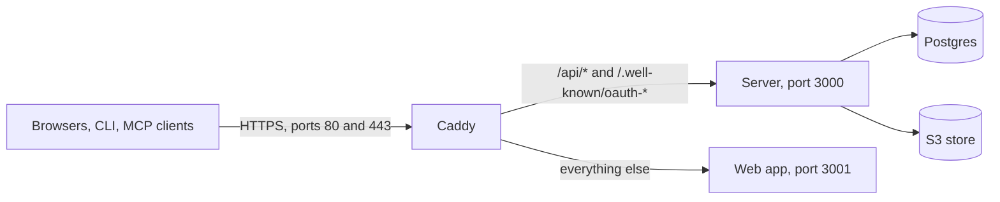

You run two programs of Peal's own, the server and the web app. Beside them you need Postgres, an S3-compatible object store and a way to send email. Peal reaches every outside service through a port with a self-hostable default, and everything else stays off until you configure it.

<Callout type="warning" title="Peal hasn't had its first release yet">
  There are no published images to run, so you build them from the repository,
  as [With Docker Compose and Caddy](#compose) shows. This page describes the
  self-hosting model the code follows, and every value on it is an example.
</Callout>

## Pick the services [#services]

Three services are required. The others are off until you give Peal their settings:

| Service        | Needed   | What Peal uses it for                                                                                    | Options                                                                                                                        |
| -------------- | -------- | -------------------------------------------------------------------------------------------------------- | ------------------------------------------------------------------------------------------------------------------------------ |
| Postgres       | Yes      | All data, and the durable jobs that publish posts and refresh platform tokens. Peal needs no Redis.      | Any Postgres server ([Database](/self-hosting/database))                                                                       |
| Object storage | Yes      | Uploaded media                                                                                           | Any S3-compatible API ([Media storage](/self-hosting/storage))                                                                 |
| Email          | Yes      | Confirming email addresses, resetting passwords, invitations, and notifications about posts and channels | Resend, or any SMTP server ([Email](/self-hosting/email))                                                                      |
| Billing        | Optional | Plans and subscriptions                                                                                  | Stripe. Without a key, billing is off and no plan limits apply.                                                                |
| Captcha        | Optional | Bot protection on sign-up and password resets                                                            | Cloudflare Turnstile. Without its keys, the captcha is off.                                                                    |
| AI             | Optional | The writing assistant in the composer, and the images it makes                                           | Anthropic's API, or any OpenAI-compatible endpoint. Images need an OpenAI-compatible image endpoint. Without one, each is off. |
| Telemetry      | Optional | Logs, metrics and traces                                                                                 | Any OpenTelemetry (OTLP) collector. Nothing is exported unless an endpoint is set.                                             |

Peal's own deployment stores media on Cloudflare R2. Its development stack runs SeaweedFS for storage and Mailpit for email. You can use any of these, or any other store and mail server that speaks the same protocols.

## Run the server and the web app [#run]

Each program has its own job:

| Program                    | What it does                                                                                                                                                                                                                    |
| -------------------------- | ------------------------------------------------------------------------------------------------------------------------------------------------------------------------------------------------------------------------------- |
| The server (`peal-server`) | The HTTP API under `/api`, sign-in under `/api/auth`, the MCP endpoint at `/api/mcp`, and the jobs that publish posts, email notifications and refresh tokens. Its image listens on port 3000 and runs as an unprivileged user. |
| The web app (`peal-web`)   | Every page, on Node. It forwards `/api/*` and the OAuth discovery documents (`/.well-known/oauth-*`) to the server at `PEAL_API_URL`.                                                                                           |

People, the command line and MCP clients all use one address, `PUBLIC_URL`. With the Compose stack below, Caddy routes each request like this:



<Callout type="warning" title="Run one server process per instance">
  MCP clients on older protocol revisions keep their sessions in the server's
  memory. Each process that runs needs its own `HOSTNAME`.
</Callout>

### The settings the server requires [#required-settings]

In production (`NODE_ENV=production`, which the server's image sets), the server won't start without these. Its error names the missing variable:

| Variable                                                                                   | What it is                                                          | Details                                                |
| ------------------------------------------------------------------------------------------ | ------------------------------------------------------------------- | ------------------------------------------------------ |
| `DATABASE_URL`                                                                             | The Postgres database                                               | [Core](/self-hosting/environment-variables#core)       |
| `PUBLIC_URL`                                                                               | The address people open Peal at, such as `https://peal.example.com` | [Core](/self-hosting/environment-variables#core)       |
| `BETTER_AUTH_SECRET`                                                                       | The secret that signs sessions: `openssl rand -base64 32`           | [Sign-in](/self-hosting/environment-variables#sign-in) |
| `AUTH_IP_HEADERS`                                                                          | The header your edge puts the client's address in                   | [Sign-in](/self-hosting/environment-variables#sign-in) |
| `MAIL_FROM`, and `SMTP_URL` or `RESEND_API_KEY`                                            | Who emails come from, and how they leave                            | [Email](/self-hosting/environment-variables#email)     |
| `PEAL_S3_ENDPOINT`, `PEAL_S3_BUCKET`, `PEAL_S3_ACCESS_KEY_ID`, `PEAL_S3_SECRET_ACCESS_KEY` | The media store                                                     | [Media](/self-hosting/environment-variables#media)     |

The web app needs `PEAL_API_URL`. To connect channels, the server also needs `PEAL_TOKEN_KEYS`. [Environment variables](/self-hosting/environment-variables) lists every setting, with its default.

## With Docker Compose and Caddy [#compose]

The repository's `packages/peal-docker` folder holds a stack you can run as it is. It has two files:

- `compose.production.yaml` runs Postgres, the server, the web app and a telemetry stack (an OpenTelemetry collector, Loki, Tempo, Prometheus and Grafana). Each one restarts when it stops, and every port is on `127.0.0.1`.
- `compose.self-host.yaml` adds Caddy in front of them. Caddy gets a certificate from Let's Encrypt, and it's the only service reachable from outside, on ports 80 and 443.

<Steps>
<Step title="Point your domain at the server">

Add the DNS record, and open ports 80 and 443.

</Step>
<Step title="Fill in the settings">

Copy `self-host.env.example` out of the repository, for example to `/srv/peal/peal.env`, and let only root read it. Fill in the domain, the secrets (the file says how to generate each one), email and the media store.

</Step>
<Step title="Build the images and start the stack">

From `packages/peal-docker`, build the images, then start every service and wait until each one is healthy:

```sh
docker compose --project-name peal --file compose.production.yaml \
  --file compose.self-host.yaml --env-file /srv/peal/peal.env build
docker compose --project-name peal --file compose.production.yaml \
  --file compose.self-host.yaml --env-file /srv/peal/peal.env up --detach --wait
```

</Step>
</Steps>

Caddy (`self-host/Caddyfile`) sends `/api/*` and `/.well-known/oauth-*` to the server, and everything else to the web app. It waits 150 seconds for an answer, which is longer than the writing assistant and the web app's forwarding wait. Set `AUTH_IP_HEADERS=x-forwarded-for`, as the example file does.

Each service joins only the Docker networks it needs. Only the server reaches Postgres, only the server sends telemetry to the collector, and only the collector and Grafana reach Loki, Tempo and Prometheus, which have no internet access. Caddy reaches the server, the web app, and the site and docs when you serve them. A service you add to the stack, such as a database tool, gets none of them until you list the network it needs under its `networks:`, for example `database` for Postgres.

After an upgrade from a version without these networks, Compose leaves the old shared network behind. Remove it once the stack is running: `docker network rm peal_default`.

### Upgrade [#upgrade]

The server applies its migrations as it starts. So to upgrade, check out a newer version and run the same two commands. Compose gives the server its 75 seconds to stop.

If your server bills, give Stripe the new release's [catalogue](/self-hosting/options#billing) between the two commands, after `build` and before `up`, with the same files:

```sh
docker compose --project-name peal --file compose.production.yaml \
  --file compose.self-host.yaml --env-file /srv/peal/peal.env \
  run --rm --no-deps server packages/peal-server/scripts/stripe-catalogue.ts
```

It changes nothing when Stripe already holds that catalogue. A server whose catalogue differs from Stripe's won't start, and it logs what differs and this command. A server that's already running reads the catalogue again only when it restarts.

### Reach Grafana [#grafana]

Grafana listens on `127.0.0.1:13000` only. Open an SSH tunnel to it, then sign in as `admin` with `GRAFANA_ADMIN_PASSWORD`:

```sh
ssh -L 13000:127.0.0.1:13000 you@your-server
```

Its alert rules come provisioned. They notify no one until you add a contact point.

### Back up Postgres [#backups]

Set `PEAL_POSTGRES_ARCHIVE_MODE=on` and the `PGBACKREST_REPO1_*` settings the example file lists. Postgres then archives its write-ahead log to that bucket with pgBackRest, which the stack's Postgres image ships.

Create the backup repository once, then take full backups on a schedule:

```sh
docker compose … exec --user postgres postgres pgbackrest stanza-create
docker compose … exec --user postgres postgres pgbackrest backup --type=full
```

Peal's own servers do this with the Ansible in `packages/peal-infra/ansible`, whose README and restore runbook show every command. [Environment variables](/self-hosting/environment-variables#compose) lists the stack's settings.

<Callout
  type="warning"
  title="Apply the erasure ledger before you start a restored server"
>
  Otherwise the accounts and workspaces deleted since the backup come back
  ([Deletions and backups](/self-hosting/privacy#erasure-ledger)). Start it with
  `PEAL_MEDIA_SWEEPS=off` until the restore is final, too. The restored database
  doesn't know the files uploaded since the backup, and the media sweeps would
  delete them ([Unfinished uploads](/self-hosting/storage#multipart)).
</Callout>

### Give Postgres more memory [#postgres-memory]

Postgres starts with PostgreSQL's own memory settings, whatever the server has. That includes 128 MB of buffers. To give it more, set these ([Environment variables](/self-hosting/environment-variables#compose) says what each one does):

- `PEAL_POSTGRES_SHARED_BUFFERS`
- `PEAL_POSTGRES_EFFECTIVE_CACHE_SIZE`
- `PEAL_POSTGRES_MAINTENANCE_WORK_MEM`
- `PEAL_POSTGRES_RANDOM_PAGE_COST`

Size them on the memory Postgres may have, not the machine's, because the server, the web app and the telemetry stack share it. Compose recreates Postgres when one of them changes, and Peal is unavailable for the seconds it takes to restart.

<Callout
  type="warning"
  title="Copy your current values into these variables before upgrading"
>
  Postgres takes these settings from its command line, which wins over `ALTER
  SYSTEM` and `postgresql.conf`. Read the current values with the query below.
  Any value that differs from the default on [Environment
  variables](/self-hosting/environment-variables#compose) is lost unless you put
  it in its variable.
</Callout>

```sql
SELECT name, setting, source FROM pg_settings WHERE name IN ('shared_buffers', 'effective_cache_size', 'maintenance_work_mem', 'random_page_cost');
```

## Put a reverse proxy in front [#reverse-proxy]

Run a reverse proxy that terminates TLS, such as Caddy, in front of the web app, and expose only the proxy. You can route in one of two ways:

- Send every request to the web app, which forwards the server's paths.
- Send `/api/*` and `/.well-known/oauth-*` straight to the server, and everything else to the web app.

### Pass on the client's address [#client-address]

Sign-in is rate limited by the client's address. The server reads it from the header that `AUTH_IP_HEADERS` names. Name only a header your edge sets, and that replaces whatever the client sent:

| Behind                                                                             | `AUTH_IP_HEADERS`  | Also set                                                                                               |
| ---------------------------------------------------------------------------------- | ------------------ | ------------------------------------------------------------------------------------------------------ |
| Cloudflare                                                                         | `cf-connecting-ip` |                                                                                                        |
| Caddy, which replaces `X-Forwarded-For` unless told to trust the proxies before it | `x-forwarded-for`  |                                                                                                        |
| Proxies that append to `X-Forwarded-For`                                           | `x-forwarded-for`  | `AUTH_TRUSTED_PROXIES` with their addresses, so the client's address is read from the right, past them |

<Callout type="warning" title="Don't expose the web app without a proxy">
  The web app passes these headers on as they come. With no proxy in front of
  it, there's no address to trust, and rate limits can't tell clients apart.
</Callout>

### Set timeouts and probes [#probes]

Let requests last at least 90 seconds through everything between browsers and the server, a tunnel included, because the writing assistant waits that long for its AI provider. The web app's own forwarding of `/api/*` waits up to 120 seconds.

The server answers two probes:

| Probe             | Answers                                                                                                                              | Suits                                                   |
| ----------------- | ------------------------------------------------------------------------------------------------------------------------------------ | ------------------------------------------------------- |
| `GET /api/health` | `204 No Content` as soon as the server is up, whatever the state of its database                                                     | A container health check. The server's image checks it. |
| `GET /api/ready`  | `204 No Content` when the database answers as well, and `503 Service Unavailable` with a `DatabaseUnavailable` error when it doesn't | A load balancer holding traffic back until then         |

## Turn on short links [#short-links]

[Short links](/guides/posts/published#short-links) are off until `PEAL_SHORT_LINK_BASE` says where they live. They can live in one of two places:

| Where                    | `PEAL_SHORT_LINK_BASE`         | What else to do                                                                                                                                                                                             |
| ------------------------ | ------------------------------ | ----------------------------------------------------------------------------------------------------------------------------------------------------------------------------------------------------------- |
| On Peal's address        | `https://<your domain>/api/l/` | Nothing. The server answers `/api/l/<code>`, which the web app forwards.                                                                                                                                    |
| On a domain of their own | `https://go.example.com/`      | Its proxy sends each `/<code>` (seven letters and digits) to the server's `/api/l/<code>`, and answers 404 to anything else. `self-host/Caddyfile` has the block, commented, with `PEAL_SHORT_LINK_DOMAIN`. |

A domain of their own keeps the redirects off the address people sign in at, in case a platform frowns on a host that redirects.

<Callout type="warning" title="Changing the base breaks the links already sent">
  Change or remove `PEAL_SHORT_LINK_BASE`, and every short link already sent
  stops working.
</Callout>

The short domain must reach the server through the same edge as the app, one that sets the header `AUTH_IP_HEADERS` names and replaces what the client sent. Without that, every visitor shares the proxy's address and the limit below. With a header the client can set, the limit bounds nothing.

The base must be a public domain the platforms recognise as a link, so you can't try short links on localhost.

A redirect is a `302` with `Cache-Control: no-store`, so every visit reaches the server and is counted, and with `X-Robots-Tag: noindex, nofollow`. Each address may follow 300 short links a minute (in each server process). Past that, it gets `429`. The limit bounds guessing codes, not clicks. The server logs the path, with its code, as it logs any path, and never where a link leads.

<Accordion>
<AccordionItem title="A proxy that can't rewrite paths">

Some proxies in front of the server can't rewrite paths, such as a tunnel that only routes them. Then rewrite `/<code>` to `/api/l/<code>` at the edge before it. Let the tunnel send only `/api/l/` followed by seven letters and digits to the server, and answer 404 to anything else on the short domain, so none of its paths reaches the rest of the server. This is how Peal's own service routes peal.link.

</AccordionItem>
</Accordion>

## Stop the server cleanly [#stopping]

When it stops, the server waits up to 60 seconds for the calls to the platforms in flight to answer. Give it at least 75 seconds before it's killed, with `docker stop --time 75` or `stop_grace_period: 75s` in Compose.

The server checks a call that was cut short when it starts again:

- On Bluesky, it reads the post back.
- On Mastodon, it sends the post again under the same key, which Mastodon keeps for an hour.

When that can't settle it, the post is marked to check, and someone has to look on the platform.

## Connect the command line and MCP clients [#mcp]

The [command line](/developers/cli) signs in with a code that people approve at `PUBLIC_URL/device`. It needs nothing more.

[MCP clients](/developers/mcp) sign in with OAuth, which needs `PUBLIC_URL` on HTTPS, or `localhost` for development. On a plain HTTP address elsewhere, such as `http://192.168.1.20:3001`, the server starts and logs a warning, and its MCP endpoint refuses every request.

Most MCP clients register themselves before they sign in. The server allows that only with `MCP_DYNAMIC_REGISTRATION=true`, and then anyone may register a client, under any name. The consent page tells people that Peal hasn't checked the client, and where it sends them back to.

## Make an account staff [#staff]

Staff (Better Auth's admin role) run the server from the [staff console](/self-hosting/staff) at `/admin`. They can find accounts and workspaces, ban accounts or sign them out, send a confirmation again, and act as a member for an hour. Each action is recorded in an audit log. Better Auth's own admin endpoints are off, except the one that stops an impersonation.

To make an account staff, set its role in the database, then sign in again:

```sql
UPDATE auth."user" SET role = 'admin' WHERE email = 'you@example.com';
```

Staff can't delete an account. Only its owner can, from [their account settings](/guides/workspace/account#delete-account), which deletes what Peal keeps about them.

While impersonating, staff can't connect channels, publish, manage API keys or billing, change workspaces, or let an application act for the member. They can read the member's notifications, but can't mark them read or change the member's email preferences. They can ask the writing assistant in the member's workspaces, and that counts toward those workspaces' daily requests.
